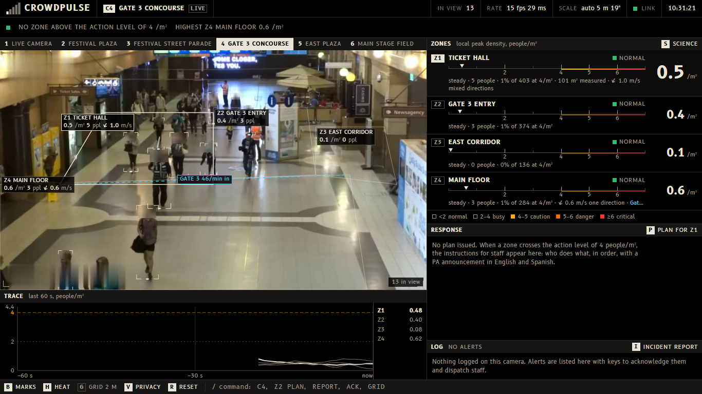
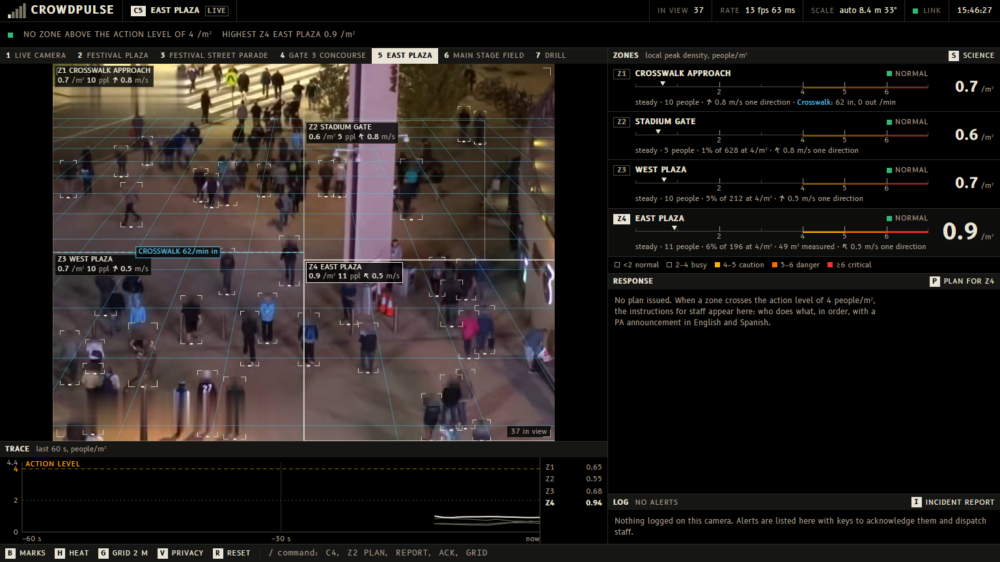
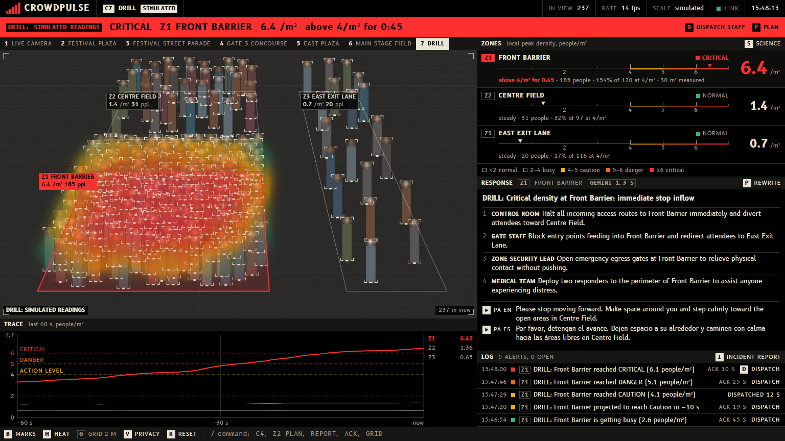

# CrowdPulse

**Real-time crowd-safety early warning from the cameras a venue already has.**

Crowd crushes build up over minutes, but staff usually see them too late. Ten people died at Astroworld (Houston, 2021) and more than 150 in Itaewon (Seoul, 2022). Crowd scientists have published the danger levels for decades: at 4 people per square metre a control room should already be acting, and around 6 people can no longer keep their footing. In the 2006 Hajj disaster the crush began more than 30 minutes after stop-and-go waves appeared in the video, and about 10 minutes after the crowd turned turbulent (Helbing et al. 2007). The warning was on camera. CrowdPulse watches the numbers.

Built by Ismail El Ktiri El Idrissi and Abir Chowdhury at **Hacklanta 2026** (theme: Music Festival) for the **Social Good track (Cox)**, with three side challenges: Mercedes Best Application of Computer Vision, MLH Best Use of Gemini API, and Photon Agents in iMessage.

**Devpost page, with the demo video:** <https://devpost.com/software/crowdpulse-w4y3pj>

**Documentation for the submission:** everything that was submitted is written up in one document: the problem and who it serves, the tracks, how it works, how to run it, what is real and what is simulated, and every technology and source. Read it as a [Word document](docs/CrowdPulse-documentation.docx) (click "Download raw file" on GitHub) or [on this site](docs/DOCUMENTATION.md).



## What it does

1. **Counts people** in a live webcam or video feed with YOLOv8.
2. **Calibrates the camera by itself.** The people in view act as a ruler (average height 1.7 m). From how tall people appear at each height in the image, CrowdPulse works out the camera's height and tilt, and so the real floor position of every person. No tape measure, no typed-in areas.
3. **Measures local density in people per m²** for each named zone, using the Gaussian-kernel local density from crowd-disaster research (Helbing, Johansson & Al-Abideen 2007). A zone's reading is its local peak, because averages hide dangerous pockets.
4. **Rates every zone on a research-based scale** (below), with a timer for how long it has been above the action level (4/m²).
5. **Forecasts** when a zone will reach the next level from its trend over the last minute.
6. **Measures how the crowd moves.** People are followed between frames, so each zone shows real walking speed in metres per second, the direction of travel, and whether people share a direction or collide in counter-flow. In crowd-disaster research, flow dropping and velocities turning erratic come before a crush; the dashboard also computes Helbing's crowd pressure (density × variance of velocity).
7. **Counts people through gates** and shows each zone against its **capacity at the action level** (measured floor area × 4 people/m²): "9 people, 3% of 284 at 4/m²", "Gate 3: 57 in, 4 out per minute".
8. **Writes a response plan with Gemini** when a zone crosses the action level: who does what, in order, plus a PA announcement in **English and Spanish** that the dashboard can **read aloud**. The camera frame is sent along with the numbers.
9. **Tracks the staff response.** Each alert can be acknowledged and marked "staff dispatched"; response times are recorded.
   **And reaches staff in iMessage** (optional, `hacklanta/`): an agent built on Photon's Spectrum SDK texts the staff on duty each alert from the action level up, Gemini's plan, and every dispatch. Staff answer in plain words: "status", "plan", "ack", "on my way". A reply of "on my way" is logged on the console as the dispatch, with the response time.
10. **Writes the incident report.** One click turns the session's alert log, peak readings and response times into a report for the safety officer (Gemini, with a plain no-AI version when offline).
11. **Protects privacy by default.** Every detected head is pixelated in the video stream. CrowdPulse counts people; it never identifies them, and no video is stored.
12. Shows it all on a **control-room console** driven from the keyboard: the camera with its zones and measured floor grid, a zone board, a 60-second strip chart, the response plan and the alert log. One line across the top says whether any zone is above the action level.
13. **Runs a labelled drill.** None of our footage is dense enough to raise an alert, and real readings are never scaled. Key `7` is a drill instead: a scripted crowd on a virtual floor fills one zone past critical and is then relieved, so staff (and judges) can see the forecast, the alerts, the automatic plan and the report. It says **DRILL: SIMULATED READINGS** on screen the whole time and on every log entry, plan and report it produces.



*A real clip. The grid is the floor the system measured from the people in view: each square is 2 m.*



*The drill, not a camera. A simulated crowd, labelled as one on the band, the picture, the log and the plan. None of the real footage looks like this.*

### Density scale

| Local density (people/m²) | Level | What happens | Source |
|---|---|---|---|
| under 2 | Normal | People move freely | Fruin, level of service; G. Keith Still |
| 2 – 4 | Busy | Movement becomes constrained and flow starts to drop. Event guidance usually plans for no more than 2/m² | Still; UK event guidance |
| 4 – 5 | Caution | The level where event control should already be acting. 4/m² is the guidance figure for a moving queue; above it congestion builds quickly | Still; Helbing & Mukerji 2012 (Love Parade) |
| 5 – 6 | Danger | 5/m² is the upper limit for standing areas. People are in physical contact and at risk if anyone pushes | Still. The UK Green Guide allows at most 4.7/m² in standing areas |
| 6 and above | Critical | People can no longer keep a stable stance, and crowd surges can start | Still; Helbing, Johansson & Al-Abideen 2007 |

CrowdPulse calls 4/m² the **action level**. A zone that stays above it for more than 6 minutes raises an exposure alert; the 6 minutes is our own setting, not a published figure.

These were checked against the sources on 10 October 2026. Two things in earlier notes did not hold up and were removed: the Green Guide does not give 4/m² as a "safe limit" (its figure is 4.7/m² for standing areas), and we could not find a published 6-minute rule.

## Run it (Windows)

You need **Python 3.11–3.13**, **Node.js 20+** and **Git**.

```powershell
git clone https://github.com/Ithugg/crowdpulse.git
cd crowdpulse
powershell -ExecutionPolicy Bypass -File scripts\setup.ps1
```

The five demo clips are included in `media/`. They keep their own licences, listed in [media/SOURCES.md](media/SOURCES.md): the MOT20 clips are CC BY-NC-SA 3.0 (non-commercial, share-alike) and the two festival clips are under the Pexels License. For AI response plans, copy `.env.example` to `.env` and paste a free Gemini API key from <https://aistudio.google.com/apikey>. Without a key the app still runs and shows pre-written plans marked "Cached plan".

```powershell
powershell -ExecutionPolicy Bypass -File scripts\start.ps1
```

The dashboard opens at <http://localhost:8000>. No test credentials are needed.

### Driving the console

Everything is on the keyboard, and every key is also a button on screen.

| Key | Action |
|---|---|
| `1` – `6` | Switch camera (webcam or a clip) |
| `7` | The drill: a simulated crowd that builds to critical in about 75 seconds, labelled as simulated |
| `↑` `↓` | Select a zone |
| `P` | Write a response plan for the selected zone |
| `A` / `D` | Acknowledge the newest alert / mark staff dispatched |
| `I` | Incident report for this camera |
| `G` | Draw the calibrated floor as a grid of 2 m squares |
| `B` / `H` / `V` | Person marks / density tint / privacy blur |
| `S` | How the numbers are measured, with sources |
| `R` | Restart the camera and clear its history |
| `/` | Command line: `C4`, `Z2 PLAN`, `REPORT`, `ACK`, `GRID` |

The play keys next to the PA announcement read it aloud; a language only plays if that voice is installed on the computer (Windows: Settings → Time & language → Speech → Add voices).

### Staff messages in iMessage (optional)

The console works without this. It needs Node.js and a free Photon project (<https://app.photon.codes>), with each staff phone added to the project's Users list.

```powershell
cd hacklanta
npm install
Copy-Item .env.example .env        # then paste PROJECT_ID and PROJECT_SECRET from the Photon dashboard
npm run start                      # with the console already running
```

Staff go on duty by texting the project's line once. To put phones on duty from the start, create `hacklanta/.env.local` with `STAFF_PHONES=+15551234567` (comma separated; the file is gitignored). The agent only listens to the console's WebSocket and sends it the same `ack_alert` and `request_plan` commands the keyboard does, so if it or the network fails the console carries on. Drill messages carry the DRILL label like everything else.

### Useful scripts

```powershell
.\scripts\py.ps1 scripts\m1_count.py --source 0 --bench 100        # inference speed on this machine
.\scripts\py.ps1 scripts\calibrate.py --source concourse           # camera fit + a metre grid drawn on the floor
.\scripts\py.ps1 scripts\check_flow.py --source concourse          # walking speeds and gate counts in the console
.\scripts\py.ps1 scripts\precompute.py --source main_field --weights yolov8s.pt --imgsz 1280
```

## How it works

```
webcam / video ─► capture thread (always the newest frame)
                    └► YOLOv8 person detection
                         └► camera calibration from person heights ─► each person's position in metres
                              └► local density per person ─► peak per zone ─► level (with hysteresis)
                                   └► linear trend over 60 s ─► time until the next level
                                        └► alerts ─► Gemini response plan (cached fallback)
FastAPI ── one WebSocket: JSON state + binary JPEG frames ──► React dashboard
```

- **Backend** (`backend/`): Python, FastAPI, OpenCV, Ultralytics YOLOv8. Everything runs locally in one process.
- **Frontend** (`frontend/`): React + Vite + Tailwind, built to static files and served by FastAPI.
- **Config** (`config/sources.yaml`): camera sources, zone polygons, thresholds. There are no zone sizes in it; areas are measured.
- The WebSocket message format is defined in [backend/schemas.py](backend/schemas.py) and mirrored in [frontend/src/types.ts](frontend/src/types.ts).
- The server listens on this computer only (`127.0.0.1`), and the WebSocket answers only the console's own pages: a browser lets any website open a socket to localhost, so without that check another tab could read the camera. There is no login, so it is not ready to be put on a shared network.

## Honest limitations

- **The numbers on screen are real measurements, not tuned for effect.** Most bundled clips show ordinary crowds and read 0.3–1.5 people/m² ("Normal"). The packed street-parade clip reads 2–3 people/m² ("Busy"). Nothing in the bundled footage reaches the 4/m² action level, and the dashboard says so.
- **The drill is simulated, and says so.** Source `7` is not a camera. Scripted people are placed on a virtual floor and seen by a virtual camera whose height and tilt we chose; their positions then go through the same density, level, forecast and alert code as a real camera's (`backend/drill.py`). It shows what the console does above the action level. It proves nothing about how well a real crowd is measured: every simulated person is "detected", which a real detector cannot do in a packed crowd. The label is added in code to the screen, the log, the plan and the report, so it does not depend on Gemini mentioning it.
- **Calibration has stated assumptions**: flat ground, an upright camera, an average person height of 1.7 m, and a lens field of view of 60° unless set per camera. On the test clips the fit predicts person height to within 6–9%. Changing the assumed lens from 45° to 75° moves the local density reading by roughly ±10–15% and the zone areas by ±30% or more.
- **When feet are not visible** (a webcam at table height), the floor cannot be calibrated. Distance is then taken from apparent body width (shoulders about 0.5 m) and the dashboard says so.
- **Walking speed is only shown where it can be measured**: a fixed camera calibrated against the floor, with at least three people followed for about a second. On the test clips it comes out at 0.5–1.7 m/s, which is what pedestrians do. A moving (drone) camera and body-size mode show no speed.
- **Gate counts are approximate.** People are followed with a simple overlap tracker, so a person who is lost and found again near the line can be missed. The counts have not been checked against a hand count. "Full in ~N min" is a worst case that assumes nobody leaves.
- **YOLOv8 undercounts packed crowds** because people hide each other, which makes it read low exactly when it matters most. A density-map crowd-counting model is the next step for crush-level scenes.
- A source can run in **replay mode** (badge shows `REPLAY`): detections computed offline are played back in sync with the clip, so a CPU-only laptop can show a dense scene smoothly. The offline pass uses a larger model and, for packed crowds, sliced detection (the frame is cut into overlapping tiles so small, half-hidden people are found): 23 people become about 170 on the street-parade clip.
- CrowdPulse is a hackathon prototype for decision support. It is not a certified life-safety system.

## Technologies and disclosures

Everything in this repository was written during Hacklanta 2026. Pretrained models, libraries, APIs and data used:

| What | Use |
|---|---|
| [Ultralytics YOLOv8](https://github.com/ultralytics/ultralytics) (AGPL-3.0), pretrained COCO weights `yolov8n` / `yolov8s` | Person detection. No model was trained or fine-tuned. |
| [Google Gemini API](https://ai.google.dev/) via `google-genai` | Response plans (structured JSON output, multimodal: metrics + camera frame) |
| [Photon Spectrum](https://photon.codes/docs/spectrum-ts) (`spectrum-ts`, `@spectrum-ts/imessage`, MIT) and Photon's hosted iMessage line | The iMessage agent in `hacklanta/`: alerts, plans and dispatches texted to staff, replies sent back to the console. Started from Photon's `create spectrum-project` template |
| OpenCV, NumPy, PyTorch | Video capture, drawing, heatmap, inference runtime |
| FastAPI, Uvicorn | Server and WebSocket |
| React, Vite, Tailwind CSS | Console |
| [B612 and B612 Mono](https://b612-font.com/) (SIL Open Font License), via `@fontsource` | Typeface. Designed by Intactile Design for Airbus, ENAC and ISAE for cockpit displays; bundled, so the console needs no network |
| Two [Pexels](https://www.pexels.com/) clips (Pexels License): a festival plaza and the Amsterdam Dance Event street parade | Festival footage, see [media/SOURCES.md](media/SOURCES.md) |
| [MOT17 / MOT20](https://motchallenge.net/) sequence previews (CC BY-NC-SA 3.0) | Surveillance-style test footage, see [media/SOURCES.md](media/SOURCES.md) |
| Claude Code (Anthropic) | AI coding assistant used throughout development |

Research the thresholds and density measure are based on:

- J. J. Fruin, *Pedestrian Planning and Design* (level-of-service scale)
- G. K. Still, *Crowd Dynamics*, PhD thesis, University of Warwick
- Sports Grounds Safety Authority, *Guide to Safety at Sports Grounds* ("Green Guide")
- D. Helbing, A. Johansson, H. Z. Al-Abideen, "The Dynamics of Crowd Disasters: An Empirical Study", *Physical Review E* 75, 2007
- D. Helbing, P. Mukerji, "Crowd Disasters as Systemic Failures: Analysis of the Love Parade Disaster", *EPJ Data Science* 1, 2012

## Project layout

```
backend/    detector, calibration, zones, flow (tracking, speed, gates), predictor, alerts, Gemini, drill, pipeline, server
frontend/   React console
config/     sources.yaml (cameras, zones, thresholds)
scripts/    setup, start, m1_count (OpenCV preview + benchmark), calibrate, check_flow, precompute, simulate_alerts
media/      demo clips (not in git) + SOURCES.md
tests/      pytest suite for the measurement, forecast, alert, Gemini-fallback, privacy-blur and drill logic
docs/       documentation for the submission, plan and status, Devpost text
DESIGN.md   the console's design system
```
