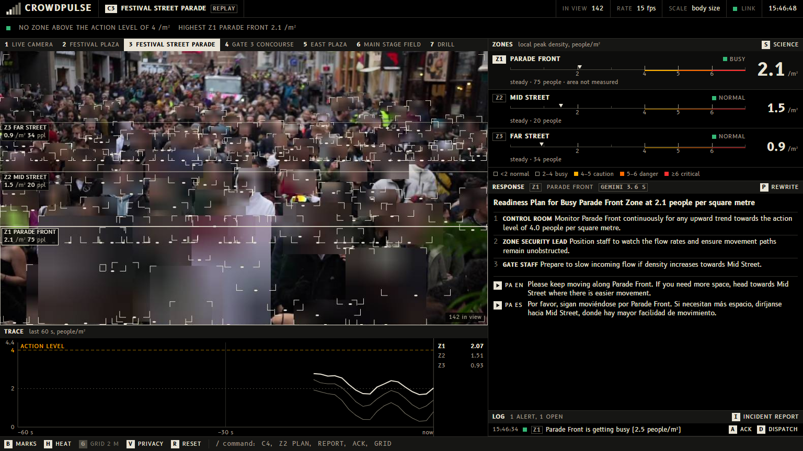
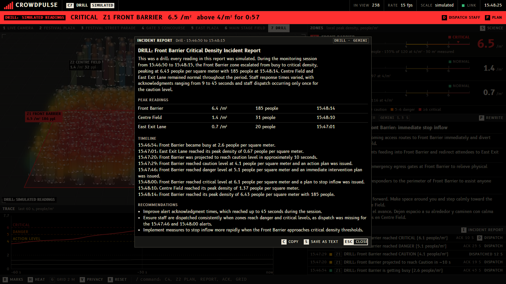

# CrowdPulse: project documentation

**Crowd-crush early warning from the cameras a venue already has, in real people per square metre.**

Submission to Hacklanta 2026 (theme: Music Festival), Georgia State University, 9 to 11 October 2026. This document collects everything that was submitted, in one place: what the project is, the tracks it is entered in, how it works, how to run it, what is real and what is simulated, and every technology and source it uses.

| Item | Detail |
|---|---|
| Project | CrowdPulse |
| Team | Ismail El Ktiri El Idrissi and Abir Chowdhury |
| Repository | https://github.com/Ithugg/crowdpulse |
| Submitted version | Tag `v1.0-demo` |
| Demo video | Linked from the Devpost project page (2 minutes 19 seconds) |
| Main track | Social Good (Cox) |
| Side challenges | Mercedes: Best Application of Computer Vision; MLH: Best Use of Gemini API; Photon: Agents in iMessage |


*The console on a recorded station concourse. One line across the top says whether any zone is above the action level.*

## 1. The problem and who it serves

Ten people died at Astroworld in 2021. More than 150 died in Itaewon in 2022. Both happened in front of cameras.

Crowd scientists have known the numbers for decades. At about 4 people per square metre a control room should already be acting. At about 6, people can no longer keep their footing. When Dirk Helbing's group went back through the video of the 2006 Hajj disaster, the warning signs were visible more than 30 minutes before the crush.

Dangerous crowd density builds slowly and in plain sight, but nobody in the control room has a number for it: a camera wall shows pictures, not people per square metre.

CrowdPulse is for the operator in an event control room and the safety officer they report to, and through them for the stewards on the ground, who get the alert and the plan on their phones. The people it protects are everyone in the crowd: at festivals, stadium concourses, transit stations on event nights and campus events. It needs no new hardware, only the cameras a venue already owns.

## 2. What it does

CrowdPulse takes a webcam or a video feed and turns it into a control-room console.

- **It finds every person in the frame**, using a pretrained YOLOv8 detector.
- **It works out the scale of the scene by itself.** People are about 1.7 m tall, so how tall they appear at each height in the picture gives the camera's height and tilt. On the plaza clip it finds a camera 8.4 m up, looking 33° down, and it can draw the floor as a grid of 2 m squares to prove it.
- **It measures each zone** in real people per square metre, how fast the crowd is walking in metres per second, which way it is moving, and how many people cross a gate line per minute.
- **It rates each zone** against published crowd-safety levels (2, 4, 5 and 6 people/m²) and forecasts when it will reach the next one.
- **It has Gemini write the response plan** when a zone crosses the action level: who does what, in order, plus a PA announcement in English and Spanish that the console can read aloud. If the zone keeps climbing, the plan is rewritten for each new level.
- **It tracks the staff response.** The operator acknowledges the alert and dispatches staff; response times are logged, and one key writes the incident report afterwards.
- **It reaches staff in iMessage.** A CrowdPulse agent, built on Photon's Spectrum SDK, texts the people on duty the alert, Gemini's plan and every dispatch. They answer in plain words ("status", "plan", "ack", "on my way"), and "on my way" is logged on the console as the dispatch with its response time.
- **It protects privacy by default.** Every head is blurred before the video is shown. It counts people; it does not identify them, and no video is stored.
- **It runs a labelled drill**, so that staff and judges can see what happens above the action level without any real reading being altered (section 6).


*A real clip. The grid is the floor the system measured from the people in view: each square is 2 m. The camera was found to be 8.4 m up, looking 33° down.*

## 3. Tracks and why CrowdPulse fits each

**Main track: Social Good (Cox).** The track asks for projects built for safety and the everyday systems communities run on. CrowdPulse is crowd safety at festivals, stations and campus events, from cameras a venue already owns, with no new hardware and no identification of anyone.

**Mercedes: Best Application of Computer Vision.** The person detector is a pretrained YOLOv8, used as published. The computer vision written for this project is what turns boxes into a measurement: the camera fits its own height and tilt from how tall people appear, every person gets a floor position in metres, density is a local peak per zone, and people are followed between frames for walking speed, direction and gate counts.

**MLH: Best Use of Gemini API.** Gemini receives the measured readings and the current camera frame (heads blurred) and returns a structured response plan, and later the incident report. Structured output guarantees the plan always has the same shape. A stored plan takes over, labelled as cached, if Gemini cannot be reached within 12 seconds. Gemini does not measure anything.

**Photon: Agents in iMessage.** An agent that lives in iMessage, built on Spectrum. It texts the staff on duty and takes their replies back into the control room, so a human is in the loop at every step and the response time comes from a real reply. If the agent or the network fails, the console carries on untouched.

## 4. How it works

```
webcam / video -> capture thread (always the newest frame)
  -> YOLOv8 person detection
  -> camera calibration from person heights -> each person's position in metres
  -> local density per person -> peak per zone -> level (with hysteresis)
  -> linear trend over 60 s -> time until the next level
  -> alerts -> Gemini response plan (stored fallback) -> iMessage agent
FastAPI: one WebSocket (JSON state + JPEG frames) -> React console
```

**Measurement.** The only assumed numbers are an average person height of 1.7 m and a lens field of view of 60°. From whole-body detections the system fits the camera's height and tilt, then places each person on the floor in metres. Density is the Gaussian-kernel local density from Helbing, Johansson and Al-Abideen's 2007 Hajj study, with a 1 m radius. A zone's reading is its local peak (90th percentile), because an average over a big area hides a dangerous pocket. When feet are not visible, as on a webcam at table height, distance is taken from apparent shoulder width (about 0.5 m) and the console says so.

**Levels.** Readings are smoothed, and a level changes only after it has held for a moment, so the display does not flicker between two levels.

| Local density (people/m²) | Level | What happens | Source |
|---|---|---|---|
| under 2 | Normal | People move freely | Fruin, level of service; G. Keith Still |
| 2 to 4 | Busy | Movement becomes constrained and flow starts to drop | Still; UK event guidance |
| 4 to 5 | Caution | The level where event control should already be acting | Still; Helbing & Mukerji 2012 |
| 5 to 6 | Danger | People are in physical contact and at risk if anyone pushes | Still; UK Green Guide (4.7/m² for standing areas) |
| 6 and above | Critical | People can no longer keep a stable stance; surges can start | Still; Helbing, Johansson & Al-Abideen 2007 |

4 people/m² is called the **action level**. It is never called a safe limit. A zone that stays above it for more than 6 minutes raises an exposure alert; the 6 minutes is this project's own setting, not a published figure.

**Forecast.** A straight line is fitted through the last minute of a zone's readings. If it will cross the next level soon, the console says when. It is an estimate from the trend, not a model of the crowd.

**Response plan.** The first alert at the action level or above gets a plan from Gemini automatically. A zone that climbs to a higher level gets a new plan at once; the old one stays on screen, tagged as being rewritten, until the new one arrives.

**iMessage agent.** A small separate Node program in `hacklanta/`. It listens to the same WebSocket as the console and sends back the same commands the keyboard does. It texts every alert from the action level up, forecasts, "cleared", each plan, and every dispatch with the plan.

**Privacy and access.** Heads are pixelated before any frame leaves the server. The server listens on the local computer only, and its WebSocket refuses pages from other websites, so another browser tab cannot read the camera.

**Software.** Python (FastAPI, OpenCV, Ultralytics YOLOv8) in one local process; a React and TypeScript console built to static files; 349 automated tests for the measurement, forecast, alert, fallback, privacy, drill and session logic. It runs on a laptop with no GPU.



*The densest real footage, a festival street parade, reads Busy. Real readings are never scaled.*

## 5. How to run it

Windows, with Python 3.11 to 3.13, Node.js 20 or newer, and Git.

```
git clone https://github.com/Ithugg/crowdpulse.git
cd crowdpulse
powershell -ExecutionPolicy Bypass -File scripts\setup.ps1
powershell -ExecutionPolicy Bypass -File scripts\start.ps1
```

The console opens at http://localhost:8000. No account, login or test credentials are needed. The demo clips are included. For live Gemini plans, copy `.env.example` to `.env` and add a free Gemini API key; without one the console still runs and shows stored plans tagged `CACHED PLAN`.

| Key | Action |
|---|---|
| `1` to `6` | Switch camera (webcam or a clip) |
| `7` | The drill: a simulated crowd, labelled as simulated |
| `G` | Draw the measured floor as a grid of 2 m squares |
| `P` | Write a response plan for the selected zone |
| `A` / `D` | Acknowledge the newest alert / mark staff dispatched |
| `I` | Incident report |
| `B` / `H` / `V` | Person marks / density tint / privacy blur |
| `S` | How the numbers are measured, with sources and what can be wrong |
| `R` | Restart the camera and clear its log |

**The iMessage agent (optional).** It needs a free Photon project (https://app.photon.codes) with each staff phone on the project's Users list. Photon's line only answers those phones, so judges cannot text the project's own line; the agent is shown at the judging table.

```
cd hacklanta
npm install
Copy-Item .env.example .env
npm run start
```

Paste `PROJECT_ID` and `PROJECT_SECRET` from the Photon dashboard into `.env` before starting, and start it with the console already running. Staff go on duty by texting the line once.

## 6. What is real and what is simulated

- **Every reading from a camera or a clip is measured.** Nothing is scaled, and there are no demo thresholds. Most clips read 0.3 to 1.5 people/m² (Normal). The densest, a street parade, reads about 2 (Busy). Nothing in the real footage reaches the action level, and the console says so.
- **The drill (key `7`) is simulated, and says so.** Scripted people stand on a virtual floor and are seen by a virtual camera; from there the same density, level, forecast and alert code runs as for a real camera. It reaches the action level about 46 seconds after it starts and critical at about 75 seconds. The words DRILL: SIMULATED READINGS are put on the screen, the log, the plan, the report and the text messages in code, so the label does not depend on the AI remembering it.
- **Anything orange or red in the screenshots and the video is the drill.**
- The drill shows what the console does above the action level. It proves nothing about how well a real packed crowd is measured: every simulated person is found, and a real detector misses people.


*The drill, not a camera: a simulated crowd, labelled as one on the band, the picture, the log and the plan.*



*The incident report from the drill, written from the alert log and tagged as a drill.*

## 7. Limitations

- **The detector undercounts packed crowds**, because people hide each other, so it reads low exactly when it matters most. On a real festival clip filmed from inside the crowd it found about 80 of several hundred people. A crowd-counting model built for dense scenes is the next step.
- **Calibration has stated assumptions**: flat ground, an upright camera, an average height of 1.7 m and a 60° lens. On the test clips the fit predicts person height to within 6 to 9%. Changing the assumed lens from 45° to 75° moves the density reading by roughly 10 to 15%.
- **Gate counts are approximate** and have not been checked against a hand count.
- **Walking speed is shown only where it can be measured**: a fixed camera calibrated against the floor.
- **Replay mode.** Three dense clips are detected offline with a larger model and played back in sync, with a `REPLAY` badge, so a laptop with no GPU can show them smoothly.
- CrowdPulse is a hackathon prototype for decision support. It is not a certified life-safety system.

## 8. Challenges, and what was learned

**Getting an honest square metre.** The first version had zone areas typed into a config file, and the densities were whatever we made them. We threw that out and wrote the self-calibration. It is the part we are proudest of and the part that took longest.

**Refusing to fake the demo.** With real measurements, none of the footage is dangerous. It was tempting to scale the numbers until something turned red. We did not, and built the labelled drill instead.

**Checking our own sources.** Two things in our notes turned out to be wrong when we went back to the papers: the UK Green Guide does not give 4/m² as a "safe limit" (its figure is 4.7 for standing areas), and we could not find a published "6-minute rule". Both are fixed in the app and the README.

**A laptop with no GPU.** Dense scenes are precomputed and replayed; the webcam and the lighter clips run live at about 15 frames per second.

**What we learned.** How crowd crushes actually happen: it is pressure and flow, not panic. Enough camera geometry to recover a floor plan from people's heights. And that writing down what can be wrong with your numbers makes them easier to believe.

**What is next.** A crowd-counting model for packed scenes; checking the gate counts and densities against hand-labelled ground truth; entering each camera's real lens angle; a trial at a real venue.

## 9. Technologies and disclosures

All code in the repository was written during Hacklanta 2026. Nothing was made before the event.

| What | Use |
|---|---|
| Ultralytics YOLOv8 (AGPL-3.0), pretrained COCO weights `yolov8n` and `yolov8s` | Person detection. No model was trained or fine-tuned |
| Google Gemini API (`google-genai`) | Response plans and incident reports, with structured output |
| Photon Spectrum (`spectrum-ts`, MIT) and Photon's hosted iMessage line | The iMessage agent. Started from Photon's project template |
| OpenCV, NumPy, PyTorch | Video capture, drawing, inference runtime |
| FastAPI, Uvicorn | Server and WebSocket |
| React, TypeScript, Vite, Tailwind CSS | The console |
| B612 and B612 Mono typefaces (SIL Open Font License) | Console typeface, bundled so it works offline |
| Two Pexels clips (Pexels License) | Festival footage |
| MOT17 / MOT20 sequence previews (CC BY-NC-SA 3.0) | Surveillance-style test footage |
| Claude Code (Anthropic) | AI coding assistant, used throughout development |

**Simulated data.** The drill is a scripted crowd on a virtual floor, not footage and not a measurement.

**Demo video.** Every picture of the product in it is the real console, recorded on the demo laptop. It was assembled with Claude Code from the open-source `/brag` recipe, with captions instead of a voice and a synthesised soundtrack. The iMessage text in it is drawn from the recorded alert and plan in the agent's own format, not filmed on a phone.

**Research the levels and the density measure are based on:**

- J. J. Fruin, Pedestrian Planning and Design (level-of-service scale)
- G. K. Still, Crowd Dynamics, PhD thesis, University of Warwick
- Sports Grounds Safety Authority, Guide to Safety at Sports Grounds (the "Green Guide")
- D. Helbing, A. Johansson, H. Z. Al-Abideen, "The Dynamics of Crowd Disasters: An Empirical Study", Physical Review E 75, 2007
- D. Helbing, P. Mukerji, "Crowd Disasters as Systemic Failures: Analysis of the Love Parade Disaster", EPJ Data Science 1, 2012

## 10. Where to look in the repository

| Path | What |
|---|---|
| `README.md` | Overview, run instructions, limitations |
| `backend/` | Detector, calibration, zones, tracking, forecast, alerts, Gemini, drill, server |
| `frontend/` | The console |
| `hacklanta/` | The iMessage agent (Spectrum) |
| `config/sources.yaml` | Cameras, zone polygons, thresholds. No zone sizes: areas are measured |
| `tests/` | 349 automated tests |
| `media/SOURCES.md` | Footage sources and licences |
| `docs/DOCUMENTATION.md` | This document as Markdown |
